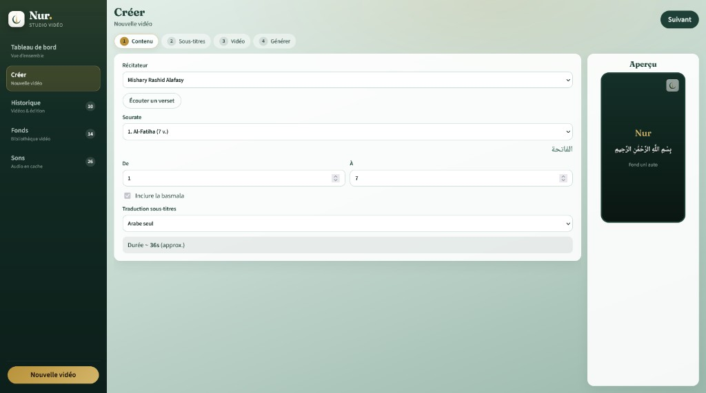
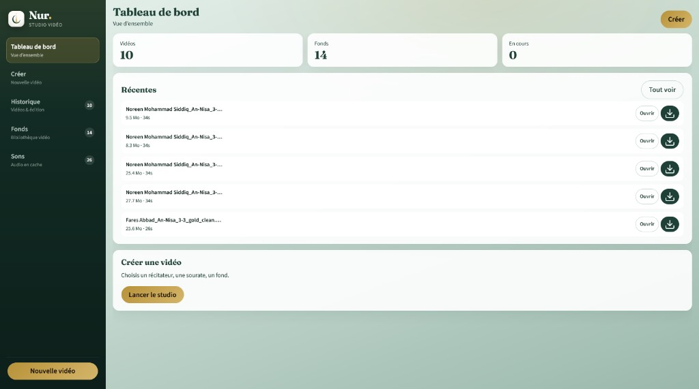
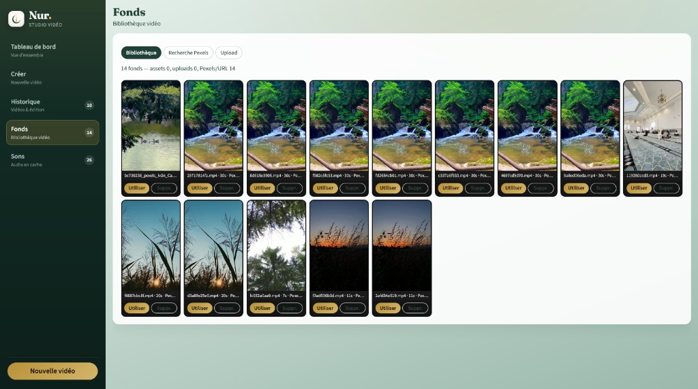
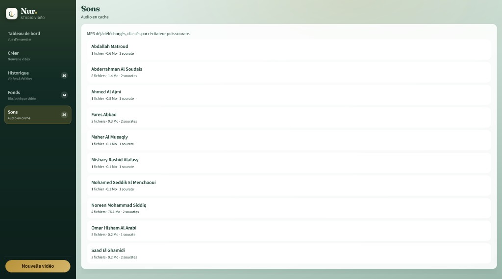

# Nur — Quran Video Studio

<p align="center">
  
</p>

**Nur** (*Noor*, "Light" in Arabic نور) is a local video studio that turns a Quran recitation into a vertical video ready for TikTok, Reels or Shorts. Pick a reciter, a surah and a verse range: Nur downloads the audio, syncs the Arabic subtitles (with an optional French or English translation), builds the video background, burns in the Nur logo, and exports a 1080×1920 MP4.

Everything runs from a full studio: dashboard, history, background library (Pexels, upload), organized audio cache, plus trimming and editing once the video is generated. No remote account needed, everything runs on your machine.



## Table of Contents

- [At a Glance](#at-a-glance)
- [Interface Overview](#interface-overview)
- [Available Reciters](#available-reciters)
- [Requirements](#requirements)
- [Installation](#installation)
- [Running the App](#running-the-app)
- [Configuration (Pexels API)](#configuration-pexels-api)
- [Project Structure](#project-structure)

## At a Glance

- **Recitation**: reciter, surah, verse range, audio preview
- **Subtitles**: Arabic only or bilingual (FR / EN), styles, animations, long verses
- **Video**: Pexels / upload / library backgrounds, render styles, mandatory Nur watermark
- **Studio**: dashboard, history, bottom credits, trim & assembly, cached audio

## Interface Overview

### Dashboard

Overview: recent videos, backgrounds, queue, quick access to the studio.



### Backgrounds

Background library: search Pexels → **Add**, then **Use** to load the background into a new creation.



### Audio

Already downloaded audio, organized by reciter then surah, ready to replay without downloading again.



## Available Reciters

| # | Reciter | Surahs | Source |
|---|---------|--------|--------|
| 1 | Abderrahman Al Soudais | 114 | EveryAyat |
| 2 | Saad El Ghamidi | 114 | EveryAyat |
| 3 | Mishary Rashid Alafasy | 114 | EveryAyat |
| 4 | Maher Al Mueaqly | 114 | EveryAyat |
| 5 | Abdelbasset Abdessamad | 114 | EveryAyat |
| 6 | Ahmed Al Ajmi | 114 | EveryAyat |
| 7 | Saoud Shuraim | 114 | EveryAyat |
| 8 | Fares Abbad | 114 | EveryAyat |
| 9 | Mahmoud Khalil Al Hussary | 114 | EveryAyat |
| 10 | Mohamed Seddik El Menchaoui | 114 | EveryAyat |
| 11 | Abdallah Matroud | 114 | EveryAyat |
| 12 | Abu Bakr Al Shatri | 114 | EveryAyat |
| 13 | Omar Hisham Al Arabi | 71 | Archive.org |
| 14 | Noreen Mohammad Siddiq | 114 | mp3quran.net |
| 15 | Yasser Al Dossari | 114 | EveryAyat |
| 16 | Hani Ar-Rifai | 114 | EveryAyat |
| 17 | Ali Al Hudhaify | 114 | EveryAyat |
| 18 | Muhammad Ayyoub | 114 | EveryAyat |
| 19 | Muhammad Jibreel | 114 | EveryAyat |
| 20 | Nasser Al Qatami | 114 | EveryAyat |
| 21 | Abdullah Basfar | 114 | EveryAyat |
| 22 | Salah Al Budair | 114 | EveryAyat |
| 23 | Khalid Al Qahtani | 114 | EveryAyat |
| 24 | Mahmoud Ali Al Banna | 114 | EveryAyat |

**Note**: The Quran has 114 surahs in total. Some reciters don't have every surah available yet (see the table).

## Requirements

- **Python 3.10+**
  Download: [python.org](https://www.python.org/downloads/)
  Check: `python --version`

- **Node.js 18+**
  Download: [nodejs.org](https://nodejs.org/)
  Check: `node --version` and `npm --version`

- **ffmpeg & ffprobe** (in your `PATH`)
  - **Windows**: [Gyan builds](https://www.gyan.dev/ffmpeg/builds/) (essentials)
    → Add the `bin/` folder to your system PATH
    Check: `ffmpeg -version` and `ffprobe -version` in a new terminal

  - **macOS**:
    ```bash
    brew install ffmpeg
    ```

  - **Linux (Ubuntu/Debian)**:
    ```bash
    sudo apt-get install ffmpeg
    ```

## Installation

### 1. Clone the repository

```bash
git clone https://github.com/OumarouSandaSouley/Nur.git
cd Nur
```

Or download directly: [ZIP archive](https://github.com/OumarouSandaSouley/Nur/archive/refs/heads/main.zip)

### 2. Install dependencies

**Windows (PowerShell)**:

```powershell
python -m pip install -r backend\requirements.txt
cd frontend
npm install
cd ..
```

**macOS / Linux (Bash)**:

```bash
python -m pip install -r backend/requirements.txt
cd frontend
npm install
cd ..
```

## Running the App

**Windows**: double-click `start.bat`, or run:

```powershell
.\start.bat
```

**macOS / Linux**:

```bash
bash start.sh
```

| Script | Platform |
|--------|----------|
| `start.bat` | Windows (cmd) |
| `start.ps1` | Windows (PowerShell) |
| `start.sh` | Git Bash / macOS / Linux |

Then open **http://localhost:5173** in your browser.
Local API: `http://127.0.0.1:8000`

## Configuration (Pexels API)

To use background search in the **Backgrounds → Pexels Search** tab:

1. Create a free key: [pexels.com/api](https://www.pexels.com/api/)
2. Before launching the app:

**Windows (PowerShell)**:
```powershell
$env:PEXELS_API_KEY = "your_key_here"
.\start.ps1
```

**macOS / Linux**:
```bash
export PEXELS_API_KEY="your_key_here"
bash start.sh
```

Or create a `.env` file at the project root:
```
PEXELS_API_KEY=your_key_here
```

## First Run (≈ 1 minute)

1. **Create** → pick a reciter (e.g. Alafasy) → short surah (**Al-Ikhlas 112**, verses 1–4)
2. **Subtitles** → Gold or Classic style
3. **Video** → Minimal style, or **Use** a background from **Backgrounds**
4. **Generate** → wait for progress → **Download**

Tip: MP3 files stay cached in `cache/audio/` and videos are written to `outputs/`.

## Studio Navigation

| Page | Purpose |
|------|---------|
| **Dashboard** | Stats, recent videos, queue |
| **Create** | Wizard: Content → Subtitles → Video → Generate |
| **History** | Preview, download, trim, assemble |
| **Backgrounds** | Library, Pexels, upload. **Use** = set as creation background |
| **Audio** | Already downloaded MP3s, organized by reciter / surah |

The **Nur** logo is always burned into videos (there is no option to remove it).
**Bottom credits** option: surah + verses on one line, reciter below.

## Project Structure

```
Nur/
├── backend/app/     FastAPI API + ffmpeg pipeline
├── frontend/        Vite + React UI (dashboard)
├── assets/          Nur logo, fonts, local backgrounds
├── cache/audio/     MP3 cache per reciter
├── cache/fonds_url/ Downloaded backgrounds (Pexels / URL)
├── outputs/         Generated videos (+ JSON / SRT sidecars)
├── docs/            Screenshots
└── start.bat        Launches API + frontend
```

## Troubleshooting

| Problem | What to try |
|---------|-------------|
| "API unreachable" | Relaunch `start.bat`; check port **8000** |
| ffmpeg not found | Reinstall the essentials build and open a new terminal |
| Empty Pexels search | Check that `PEXELS_API_KEY` is set in your environment |
| Generation stuck | Single in-memory worker: don't run the API with `reload=True` |
| Port 5173 already in use | Change the port in `frontend/vite.config.ts` |

## Useful Links

- **Reciter sources**:
  - [EveryAyat](https://everyayat.com/): 22 reciters (verse by verse)
  - [Archive.org](https://archive.org/): Omar Hisham Al Arabi (71 surahs)
  - [mp3quran.net](https://mp3quran.net/): Noreen Mohammad Siddiq (114 surahs)
- Quran: [Quran.com](https://quran.com/)
- Backgrounds: [Pexels](https://www.pexels.com/) (free, open license)
- ffmpeg guide: [ffmpeg.org](https://ffmpeg.org/)
- API docs: [FastAPI](https://fastapi.tiangolo.com/)

## License

Nur: source code for **personal use** · public recitations · backgrounds: Pexels license

I hold no rights over the Quranic recitations (public works) or the Pexels backgrounds (Pexels license).
The source code is free for personal use.

Created by [Oumarou Sanda Souley](https://github.com/OumarouSandaSouley)

### Contact

[](https://www.linkedin.com/in/oumarou-sanda-souley/)
[](https://x.com/OumarouSaSouley)
[](https://www.oumarouss.saaretech.com/)

**Need help?** Open an issue on [GitHub](https://github.com/OumarouSandaSouley/Nur/issues)
